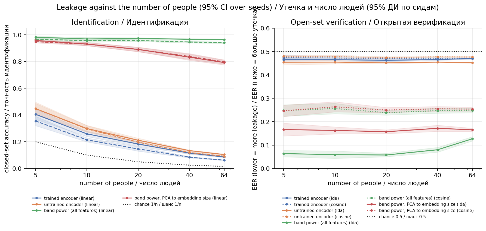
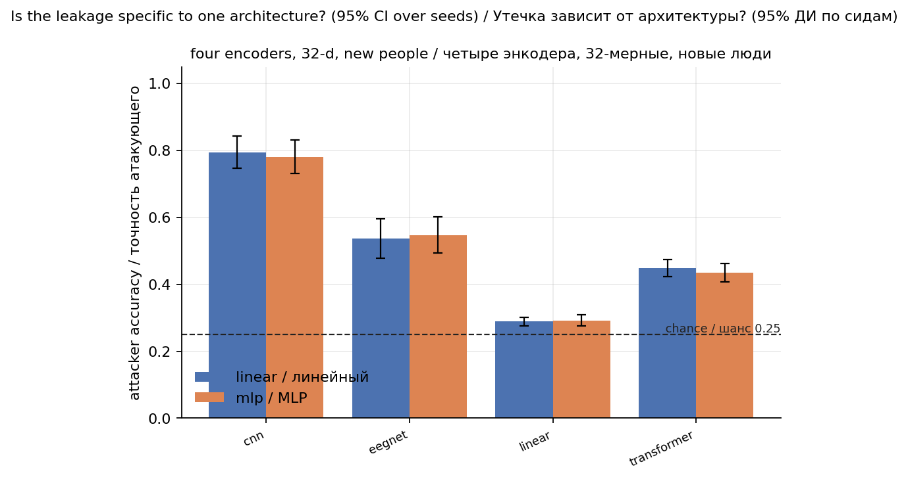
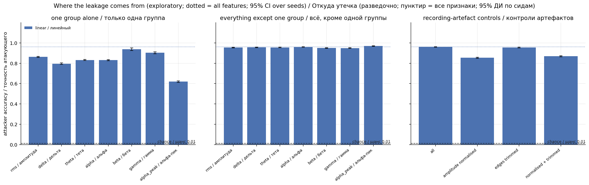

# Neural Interface Privacy Lab

*EEG decoding, identity leakage, and the cost of defences.*

**Project site: [am1dreaming.github.io/neural-interface-privacy-research](https://am1dreaming.github.io/neural-interface-privacy-research/)** — the findings, charts and pre-registered tests on one page.

Open ML and cybersecurity research: can a sentence be decoded from non-invasive EEG, do the embeddings of such a decoder reveal who the person is, and what do defences cost? Status as of 6 November 2026. Development results and the one-shot held-out evaluation are both in (see "Extended audit").

## Key findings

1. **No evidence of EEG → sentence decoding.** On ZuCo 2.0 (natural reading, 16 people, 349 sentences), new people and new sentences give top-1 of 1.2–1.3% against a random level of 1.1–1.3%. A ridge model on spectral features and a neural network on raw EEG are equally at chance. The method is sensitive, though: a synthetic signal at 5% of the noise amplitude is found in 64–73% of cases.
2. **A data trap.** Within one person the result is 4.7% (4× chance), but a baseline that never sees EEG and only knows the sentence's position in the session gets 13.1%. With test blocks of 30 consecutive sentences it falls back to chance. Random splits leak through neighbouring sentences, so real data needs a block split.
3. **Identity leaks, and it comes from the signal, not from the decoder.** Spectral features identify a person at 99.6–100% on ZuCo (16 people) and at 96.5% among 64 people on a second dataset (EEGMMIDB, chance 1.6%), even after PCA to 32 dimensions (79%). A 32-d encoder keeps much less, and a *trained* encoder leaks no more than an *untrained* one with the same initialisation (less, for three of four architectures). Training for text does not create the leak; the information is already in the spectrum.
4. **Defences have a price.** The best one tested (PCA to 8 directions) is almost free in accuracy. Subtracting identity directions and adversarial training do not protect against a strong attacker.
5. **Per-person adapters** no longer hurt, but a benefit could not be shown.
6. **The leak is spread out.** No single frequency group is necessary (removing any one changes accuracy by ≤1.1 points), and a single channel already identifies a person well above chance. Normalising amplitude per recording lowers accuracy from 0.96 to 0.85, so part of it is amplitude (contact, cap fit), but most survives. These are within-session results; they do not show that the fingerprint is stable over days.

Everything is reproducible and comes with controls (position oracle, block split, planted signal, untrained encoder). Null results are included.

## Setup

**Data.** ZuCo 2.0, normal reading: 16 people, 349 sentences, 105 EEG channels, 500 Hz. After the quality filter 5264 of 5584 recordings remain (261 without EEG, 59 broken). Put the data in `data/raw/zuco/` (it is not included in the repository). Dataset: Hollenstein et al., "ZuCo 2.0", LREC 2020; its licence is defined by the dataset authors.

**Decoding task.** Given an EEG recording, pick the sentence that was read among ~80–90 unseen ones (random top-1 ≈ 1.1–1.3%). Sentences come from articles and follow each other by topic.

**Attacker model (identity leakage).** Reference-set linkage: the attacker has each person's representations on some sentences and names the person from representations of other sentences. Test blocks of 30 consecutive sentences. Attackers: a linear probe and an MLP.

**Principles of honest evaluation.** The EEG-to-text literature has known methodological problems (split leakage, teacher forcing, results at noise level). So:

- splits are made by person, by sentence and by block, and tests check for the known kinds of leakage;
- every experiment prints baselines by default: random level, noise input, shuffled labels, position oracle;
- the contribution of the signal is measured as the difference from a baseline, not as an absolute metric;
- comparisons are paired across seeds, with 95% confidence intervals.

## Results

### 1. Sentence decoding (ZuCo 2.0, 16 people)

| Setting | New people | Same person |
|---|---|---|
| Ridge, **random** test sentences | 1.3% (position oracle 13.8%) | 4.7% (oracle 13.1%) |
| Ridge, test sentences in **blocks of 30** | 1.2% (oracle 2.2%, random 1.3%) | 1.2% (oracle 1.9%, random 1.1%) |
| Neural network on raw EEG (1 seed, random sentences) | 0.6% (noise input 1.0%) | not tested |

- There is no evidence that the sentence can be determined from EEG in any setting.
- The within-person "signal" is explained by the structure of the data, not by language. The position oracle, which never sees EEG, gets 13.1%, and with blocks of 30 only the random level remains. A random split hands out a hint through neighbouring sentences (topics and slow drift of the recording), so real data uses `split.block_size` by default.
- Sensitivity was measured: a synthetic signal at 5% of the noise is found in 64–73% of cases. The signal is idealised (linear, identical across people, fitted to the target text representation), so the detection threshold for a real signal is probably worse.
- This is **not** proof that EEG carries no information about language: features are averaged over the sentence, text is encoded with plain TF-IDF, and word-level time alignment was not tested.

### 2. Identity leakage (ZuCo 2.0, 10 seeds)

Accuracy of a probe that names the person from a representation:

| Representation | New people (4, chance 25%) | All 16 (chance 6.3%) |
|---|---|---|
| Full spectral features (840) | 99.6% | 100% |
| Same, PCA to 32 | 99.1% | 100% |
| Untrained encoder (same initial state), linear / MLP | 49% / 52% | 23% / 25% |
| Trained encoder (32), linear / MLP | 45% / 44% | 15% / 14% |

Paired difference "trained minus untrained" (95% interval over seeds). New people: linear −0.041 [−0.079, −0.003], MLP −0.084 [−0.126, −0.042]. All 16: −0.082 [−0.097, −0.067] and −0.114 [−0.128, −0.100].

- The spectral features alone identify a person almost without error, and compressing to 32 dimensions does not remove this: dimensionality is not the cause.
- The encoder keeps noticeably less (45% against a 25% chance level among new people), and training **reduces** leakage. The cause was not investigated. A possible explanation: alignment with text moves the representation away from differences between people, while an untrained network simply passes part of the input through.
- For the linear probe on new people the upper bound of the interval is only −0.003, so the estimate is conservative.
- "Training reduces leakage" applies to an encoder that cannot decode text (see section 1). A working decoder might behave differently.

### 3. Defences and their price (synthetic, 24 people, 10 seeds)

Real data is not suitable here: the decoder on it is at chance, and the "cost in quality" would be measured from zero. Defences are therefore tested on synthetic data where the decoder works (top-1 0.37 against a random 0.03). The attacker is adaptive: the probe is trained on the protected representations of other sentences from the same people. Cost is measured on new people and new sentences. Figure: `results/defence_tradeoff.png`.


No defence: top-1 0.371; the attacker names the person (among 6 new people, chance 0.167): linear probe 0.324, MLP 0.492.

| Defence | Decoder top-1 | MLP attacker | Takeaway |
|---|---|---|---|
| PCA, 8 directions | 0.345 (−0.026, not distinguishable) | 0.373 (−0.120) | almost free, best of those tested |
| PCA, 4 directions | 0.190 (−0.181) | 0.281 | leakage falls, accuracy halves |
| Noise, norm 0.5 | 0.329 (−0.041) | 0.395 (−0.097) | reasonable compromise |
| Noise, norm 1.0 | 0.257 (−0.113) | 0.283 (−0.209) | accuracy 30% lower |
| Noise, norm 2.0 | 0.153 (−0.217) | 0.198 | attacker almost at chance (0.167), but the decoder is badly damaged |
| Subtract 8 identity directions | 0.278 (−0.093) | 0.476 (not distinguishable) | has a cost, no protection from the MLP |
| Train against an "identity guesser" (weight 8) | 0.337 (−0.033) | 0.528 (**+0.036**) | leakage did not fall, it rose for the MLP |

- Subtracting identity directions barely bothers a non-linear attacker (linear probe 0.324 → 0.289, MLP 0.492 → 0.476). Assessing privacy needs a strong attacker, not just a linear probe.
- PCA turned out to be the best defence: cheaper than noise 0.5 and it cuts leakage more. But this is one scenario on synthetic data where differences between people are defined as channel mixing, so on live EEG the ranking of defences may differ.
- With these parameters adversarial training did not help new people. This does not prove it cannot work: the parameters were not tuned.
- Instead of LDA direction subtraction, subtraction of the subspace of per-person means is used, because after removing all LDA directions 16% of the separation of the means remained.
- The strength of between-person differences in the synthetic data was chosen using the no-defence condition only. A first trial run on one seed was seen before the list of defences was fixed. 15 settings were tried without correction for multiple comparisons.
- There are 6 new people in the test per seed; the synthetic data is regenerated on every seed, so seeds are independent.

### 4. Per-person adapters (synthetic)

The base model is frozen and a light adapter is trained per person (channel scaling, low-rank, channel mixing).

- The initial variant made results worse. Paired comparison with zero calibration over 10 seeds: 2 sentences −0.046 [−0.075, −0.017], 4 sentences −0.076 [−0.132, −0.020], 8 sentences −0.033 [−0.074, +0.008].
- The harm came from overfitting: with a smaller step and fewer epochs (lr 1e-3), or with a penalty for departing from the identity transform, it disappears. Both components hurt on their own.
- No variant shows a benefit, even when between-person differences are amplified (`smoke_synthetic_highvar.yaml`, zero calibration is ≈0.24 there).
- A channel-mixing adapter gave +0.06 at 8 sentences on the first 10 seeds, but variant J, chosen in advance, gave +0.018 [−0.004, +0.039] on 20 new seeds: **not confirmed** (a winner's-curse effect among ~12 variants). The comparison is partly circular: in the synthetic data the between-person differences are exactly channel mixing.
- Result: adapters stopped hurting, a benefit is not proven. There are 3 new people in the synthetic test.

### 5. Pipeline notes (synthetic)

- The smoke run on synthetic data checks that the pipeline works: the gain over baselines is positive, and on noise and shuffled labels it stays near the random level. This is not a scientific result.
- The first version of the identity probe split records randomly, and accuracy came out **below** the random level (repeats of one sentence landed in both training and test). The split is now by sentence (`groups=`).
- A single run is too noisy for comparisons: a small test shifts top-1 by several points. For conclusions use `run_seeds.py`. The same seed gives the same result (checked by a test).
- Quantisation: standard PyTorch builds for macOS lack the needed engine, so the int8 size cannot be measured. In that case `quantized_size_bytes` returns `None`, and `estimate_int8_linear_bytes` gives an analytical estimate (on Linux it differs from the measurement by about 6%).

## Extended audit (development results and the one-shot held-out evaluation)

`PREREGISTRATION.md` fixes the hypotheses, metrics, the held-out group and the multiple-comparison rule. Two groups of people are used on EEGMMIDB (109 people, 64 channels, no text): 85 development people (84 usable) and 24 held-out people (22 usable) that were evaluated **once**, at the very end (`experiments/final_holdout.py`, code and `PREREGISTRATION.md` committed as `d6587c0` before the run). Sections 6–8 are on ZuCo or on the development group; section 9 is the held-out evaluation. Confirmatory and exploratory results are kept apart.

**Timing, stated plainly.** `PREREGISTRATION.md` was written on 5 November 2026 at 21:31 UTC (file time), before the 10-seed runs for H2, H4 and the ablation; its hypotheses were not edited afterwards (a dated addendum about this timing was appended on 7 November). But the first commit that contains it (`d6587c0`) was made on 6 November (UTC), *after* those runs. So for H2 and H4 the order "plan, then results" rests on a local file time and is not externally verifiable. Only family A (H1, H3, section 9) was run provably after the commit.

EEGMMIDB has no text, so only the leakage side is tested there: the encoder is aligned with an embedding of the instructed run type (plus a random per-run component), so "trained encoder" on this dataset is **not** a text decoder. Decoding quality is neither measured nor claimed.

### 6. Leakage against the number of people (EEGMMIDB, development group, 10 seeds) — confirmatory (H2)

Encoder trained on 20 people, attacker evaluated on people the encoder never saw. Chance is 1/n.

| People (n) | 5 | 10 | 20 | 40 | 64 |
|---|---|---|---|---|---|
| Chance | 0.200 | 0.100 | 0.050 | 0.025 | 0.016 |
| Spectral features, all (linear) | 0.982 | 0.969 | 0.973 | 0.967 | 0.965 |
| Spectral features, PCA to 32 (linear) | 0.958 | 0.931 | 0.891 | 0.833 | 0.793 |
| Untrained encoder (linear) | 0.448 | 0.299 | 0.212 | 0.134 | 0.104 |
| Trained encoder (linear) | 0.406 | 0.259 | 0.183 | 0.115 | 0.086 |

Open-set verification (LDA score fitted on *other* people; EER, 0.5 = chance): spectral features 0.064 → 0.127 from n=5 to n=64, PCA-32 about 0.16, trained encoder 0.462–0.470, untrained encoder 0.452–0.455.



- **H2 is confirmed in all 10 pre-registered tests** (accuracy above 1/n and LDA EER below 0.5 at every n, Holm over 10). For the trained encoder the effect is real but small in verification (EER about 0.47).
- Attacker access matters more than anything else: with the full spectral features closed-set accuracy barely drops from 5 to 64 people; through a 32-d trained encoder it falls to about 5× chance.
- The untrained encoder is as leaky as or leakier than the trained one, as on ZuCo.

### 7. Four encoders on ZuCo (new people, 10 seeds) — confirmatory (H4) plus exploratory contrast

32-d embeddings, 4 new people per seed (chance 0.25). Table: `results/encoders_table.md`.

| Encoder | Linear probe | Excess over chance | LDA EER | Trained − untrained (exploratory) |
|---|---|---|---|---|
| CNN | 0.794 | +0.544 [+0.496, +0.593] | 0.395 | −0.126 [−0.160, −0.092] |
| EEGNet | 0.537 | +0.287 [+0.229, +0.345] | 0.456 | +0.075 [+0.023, +0.127] |
| Transformer | 0.448 | +0.198 [+0.172, +0.224] | 0.482 | −0.041 [−0.079, −0.003] |
| Linear (PCA-like) | 0.289 | +0.039 [+0.025, +0.052] | 0.500 | −0.031 [−0.053, −0.008] |



- **H4 is confirmed for all 8 tests** (every architecture is above chance for both probes, Holm over 8). For the linear encoder the excess is statistically clear but practically negligible.
- The trained-minus-untrained contrast was **not** a pre-registered test. Three architectures leak less after training; only EEGNet leaks more.
- Closed-set accuracy overstates the open-set risk: the CNN reaches 0.79 accuracy but only 0.395 EER, and the transformer has +0.20 excess but EER 0.48.
- Do not read the ranking as a statement about architectures in general. The CNN probably keeps channel-wise power more directly, but this was not tested; parameter counts differ.
- H4 was **not blind**: a 3-seed, 5-epoch probe run on ZuCo preceded the pre-registration file (listed in its section 6).

### 8. Where the leakage comes from (EEGMMIDB, development group, 5 seeds) — exploratory

84 people, chance 0.012, linear probe on interpretable features.

| Setting | Accuracy | LDA EER |
|---|---|---|
| All features (512) | 0.960 [0.957, 0.964] | 0.084 |
| Only beta | 0.937 | 0.082 |
| Only gamma | 0.903 | 0.122 |
| Only RMS | 0.863 | 0.168 |
| Only alpha / theta / delta | 0.830 / 0.832 / 0.796 | 0.15–0.22 |
| Only individual alpha peak | 0.620 | 0.228 |
| Control: amplitude normalised per recording | 0.854 | 0.183 |
| Control: edges trimmed 10% | 0.955 | 0.090 |
| Control: normalised and trimmed | 0.868 | 0.197 |



- Removing any one group costs at most 0.011 accuracy: the information is redundant. Removing the alpha peak slightly *raises* accuracy.
- Single channels give +0.29 to +0.41 over chance (occipital strongest: Iz, Oz, O1; frontal weakest).
- At 80 Hz the "gamma" group is capped at 0.9×Nyquist (about 36 Hz), so it is the upper beta range, not true gamma. Beta and upper-beta features can include muscle activity, which is also person-specific. The ablation does not separate brain from muscle or from recording conditions.

### What did not work, or is not shown

- Decoding sentences from EEG: at chance in every setting (section 1). Deliberately not improved.
- Adversarial training and identity-direction subtraction as defences against a non-linear attacker (section 3).
- Per-person adapters: no benefit shown (section 4).
- The individual alpha peak as an identity carrier: much weaker than band power, and not needed.
- Learned-encoder training as the source of the leak: it is not (sections 2, 6, 7).
- Embedding size (4 to 64): planned as exploratory in the pre-registration, not run.
- H3b: whether an MLP recovers identity after nulling 32 directions remains open (section 9).

### Threat model in one paragraph

An attacker who holds reference recordings of the people and gets either raw EEG, its spectral features, or an embedding from any encoder tested here can name the person well above chance. The strongest channel is the spectral features themselves (96.5% among 64 people, EER 0.06–0.13). Embeddings from a small encoder leak much less, and in an open-set "same person or not" setting for unseen people they are close to chance (EER 0.45–0.50) except for the CNN on ZuCo. This is within one recording session; cross-day stability is untested. Defences that act on the embedding do not address leakage from the raw signal.

### 9. Final held-out evaluation (22 new people, 10 seeds) — confirmatory (H1, H3)

The encoder is trained on the 84 development people; the attacker is then evaluated on 22 held-out people the encoder has never seen (chance 1/22 = 0.045). One run, no reruns (`results/log_final.txt`, no entry in `results/deviations.log`).

| Pre-registered test (family A, Holm over 6) | Estimate [95% CI] | Verdict |
|---|---|---|
| H1 linear probe accuracy > chance | 0.163 [0.148, 0.177] | **confirmed** |
| H1 MLP probe accuracy > chance | 0.126 [0.114, 0.138] | **confirmed** |
| H1 cosine EER < 0.5 | 0.478 [0.471, 0.484] | **confirmed** |
| H1 LDA EER < 0.5 | 0.464 [0.459, 0.469] | **confirmed** |
| H3a identity-nulling (m=32) lowers the linear probe | −0.109 [−0.121, −0.097] | **confirmed** |
| H3b MLP stays above chance under identity-nulling (m=32) | 0.048 [0.045, 0.051] vs 0.045 | **not confirmed** (Holm p = 0.056); by the pre-registered rule also not refuted, since the point estimate is above chance |

- **The leakage replicates on people the model never saw**: about 3.6× chance for the linear probe, similar to the development result for 20 people (0.183 [0.166, 0.200]; there the encoder was trained on 20 people, here on 84, so the two are not a like-for-like comparison). Verification is weaker (EER 0.46–0.48), as in every earlier setting.
- **H3b failed.** After removing 32 identity directions the MLP is at 0.048 against a chance of 0.045; we cannot claim it is above chance, but the interval also does not exclude a small residue. So on this data, subtracting enough identity directions removed almost everything, including for a non-linear attacker. This differs from the synthetic data (section 3), where subtraction of 8 directions did not stop the MLP. The two settings differ in the number of directions, the data and the encoder, so this is not a contradiction, but it means the section-3 conclusion should not be generalised.

Exploratory (outside the pre-registered family): all defences on the same held-out people.

| Defence | Linear | MLP | LDA EER |
|---|---|---|---|
| none | 0.163 | 0.126 | 0.464 |
| noise, norm 0.5 | 0.092 | 0.078 | 0.484 |
| noise, norm 1.0 | 0.075 | 0.066 | 0.490 |
| PCA, 4 directions | 0.083 | 0.074 | 0.482 |
| PCA, 8 directions | 0.114 | 0.092 | 0.471 |
| identity-nulling, m=8 | 0.105 | 0.092 | 0.482 |
| identity-nulling, m=32 | 0.054 | 0.048 | 0.498 |
| adversarial, weight 1.0 | 0.146 | 0.114 | 0.469 |

- Adversarial training barely helps (0.163 → 0.146), consistent with section 3.
- **These defences are measured on the privacy side only.** EEGMMIDB has no text, so there is no decoder whose accuracy could be traded off. Their price (section 3) is untested on this data, and a defence that wipes the embedding would score best here.

```bash
python data/download_eegmmidb.py                                                    # ~2 GB, resumable
python experiments/encoder_robustness.py --config configs/zuco2_nr.yaml --seeds 10
python experiments/scaling_curve.py --config configs/eegmmidb.yaml --seeds 10
python experiments/feature_ablation.py --config configs/eegmmidb.yaml --seeds 5 --probes linear --channels
python experiments/make_plots.py                                                    # every figure that has results
python experiments/final_holdout.py --config configs/eegmmidb_final.yaml --seeds 10 # ONCE, last (done)
# pipeline check without any data (synthetic, not a result):
python experiments/scaling_curve.py --config configs/audit_synthetic.yaml --seeds 3 --n-list 3 5 8 --n-train 10 --epochs 3
```

## Limitations

- Identity leakage was measured within a single session (one recording per person), on ZuCo and on EEGMMIDB. For another day accuracy may be noticeably lower. Absolute power can carry a fingerprint of the session and equipment rather than of the brain; the amplitude-normalised control keeps 0.85, which is a partial check only.
- There are 4 new people in the test on real data and 6 on synthetic. Seeds change initialisation and the choice of "new people" but not the data, so intervals over seeds are a lower bound.
- Defences were tested on synthetic data only.
- Open-set verification was measured on ZuCo (encoders), on the EEGMMIDB development group and on the 22 held-out people.
- On EEGMMIDB the encoder target is synthetic (run type), so "trained encoder" results there say little about a real text decoder.
- Seeds are not independent replicates on a fixed dataset; all intervals over seeds are a lower bound on the uncertainty.
- Decoding results apply to sentence-averaged features and to TF-IDF as the text encoder.

## Related work

Status as of 1 November 2026. Abstracts and pages were read; only numbers checked against the source are quoted.

- **Tai, "Pretrained, Frozen, Still Leaking"** ([arXiv 2606.09189](https://arxiv.org/abs/2606.09189), June 2026). Audit of frozen BIOT, LaBraM and EEGPT embeddings. Identity linkage is strong when the attacker has a reference set of candidate subjects, but the authors explicitly note that for held-out subjects they claim attribute leakage, not identity recovery, and that the strong identity result does not replicate on Sleep-EDF. A noise defence against an adaptive attacker and DP-SGD leave the attribute leakage channel essentially unchanged. Not about text.
- **Chebrolu et al.**, "Disentangling Neural Identity from Encoder Identity in a Privacy Audit of BP-GPT's fMRI-to-Text Decoding" ([NeurIPS 2026 page](https://neurips.cc/virtual/2026/160157)). 8 participants: embeddings and raw functional connectivity identify a person at 100% (chance 12.5%), but BP-GPT trains a separate encoder per participant, which leaves a signature of its own. Matching against profiles from independently seeded encoders gives 54.3% (95% CI 46.6–61.6%). The idea of separating the data fingerprint from the model fingerprint is close to our untrained-encoder control.
- **Srivastava, Bellet, Tommasi, Vincent**, "Privacy-Preserving Adversarial Representation Learning in ASR: Reality or Illusion?" ([Interspeech 2019, arXiv 1911.04913](https://arxiv.org/abs/1911.04913)). Adversarial training sharply lowers closed-set speaker classification accuracy but does not raise open-set verification error on unseen speakers, so it gives no protection. Our result on adversarial training and new people is consistent with this precedent.
- **Jo et al., 2024:** EEG-to-text models on ZuCo give similar results on pure noise input; consistent with our null result on decoding.
- Protecting identity in EEG with perturbations, masking and adversarial training, mostly in a closed setting on the same people: Meng et al. 2023, Chen et al. 2024, ID-RemovalNet 2025, SAFE, NeuroPriv 2026.

**Not new:** the fact that EEG and its embeddings leak identity; that noise, compression and masking reduce it; that adversarial identity removal can be an illusion against new people; that EEG-to-text results must be tested against noise.

**Possibly new** (absence of prior work is not proven, the search was not exhaustive): an audit of the embeddings of a sentence-level EEG decoder on natural reading; a population of "new people"; the control "untrained encoder with the same start"; the leakage-versus-decoder-accuracy trade-off for four defences against an adaptive non-linear attacker; controls for EEG → sentence (position oracle, block split, planted signal); open reproducible code.

## Structure

```
configs/        yaml experiment configs
data/           preparation instructions and scripts (the data itself is not stored in git)
src/neurotext/
  data/         splits, ZuCo 2.0 and EEGMMIDB loaders, synthetic data
  models/       encoders (transformer, linear, CNN, EEGNet), text alignment, adapters
  eval/         metrics and baselines
  privacy/      identity-leakage probes, open-set verification
  features.py   interpretable features and recording-artefact controls
  plots.py      all figures from the result files
  efficiency/   parameter counting, channel subsets, quantisation (no experiments on these in the report)
experiments/    one file = one experiment
results/        figures
tests/          including split-leakage tests
```

The Python package is called `neurotext` for historical reasons.

## Quick start

```bash
pip install -e ".[dev]"
pytest
```

Smoke run on synthetic data (a pipeline check, not a scientific result):

```bash
python experiments/run.py --config configs/smoke_synthetic.yaml                  # one seed, verbose output
python experiments/run_seeds.py --config configs/smoke_synthetic.yaml --seeds 10 # repeats and confidence intervals
```

## Reproducing the results

Real data (ZuCo 2.0 in `data/raw/zuco/`; PyTorch is required for the network and the encoder):

```bash
python experiments/ridge_baseline.py     # flags --block-size, --designs, --plant
python experiments/run.py --config configs/zuco2_nr.yaml
python experiments/identity_leakage.py --config configs/zuco2_nr.yaml --seeds 10
```

Synthetic data:

```bash
python experiments/defence_tradeoff.py --config configs/defence_synthetic.yaml --seeds 10   # ~25 minutes
python experiments/plot_defence_tradeoff.py                                                 # results/defence_tradeoff.png, needs matplotlib
python experiments/adapter_sweep.py --config configs/smoke_synthetic_highvar.yaml --seeds 10 --only A F I J
python experiments/adapter_sweep.py --config configs/smoke_synthetic_highvar.yaml --start-seed 100 --seeds 20 --only A J   # check on new seeds
```

## Scope

See [ETHICS.md](ETHICS.md). Only explicit tasks (text that was read or heard) and open data collected with participants' consent. The project does **not** decode inner speech or hidden intentions, and does not try to.

## License

MIT, see [LICENSE](LICENSE). Data is not included in the repository. Dataset licences are defined by their authors.
